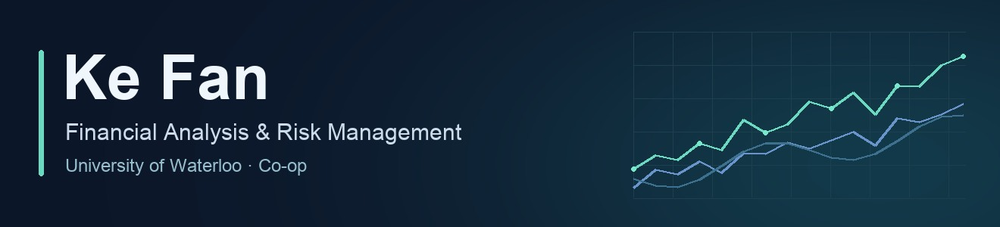

<h1></h1>

Market risk · Asset–liability management · Quantitative modeling

I study Financial Analysis and Risk Management at the University of Waterloo and expect to graduate in May 2028. During my finance and risk management co-op at HengTai Securities, I monitored exposures across public and private fund products representing $300M+ in assets under management. I used Excel and Python to analyze fund performance and benchmark deviations, and drew on regulatory filings and internal SQL data for investment research and due diligence.

## Selected projects

| Case study | What to investigate | Interactive demo |
| :--- | :--- | :--- |
| **[CAD Multi-Asset VaR & Expected Shortfall](https://github.com/321NERIN/var-es-engine)** | Compare historical simulation, delta-normal, delta-gamma and Gaussian/Student-t Monte Carlo for a CAD 10M reference book with a short USD/CAD straddle. Across 750 out-of-sample forecasts, delta-normal produced 12 breaches and Student-t Monte Carlo produced 9. | **[Open paper trading desk](https://321nerin.github.io/var-es-engine/simulator.html)** · [Model and backtest](https://321nerin.github.io/var-es-engine/) |
| **[Canadian Pension Surplus Risk & LDI](https://github.com/321NERIN/pension-ldi-lab)** | Sweep interest-rate hedge targets for a fictional defined-benefit plan. Under the displayed stress, the 76% DV01 hedge had CAD 73.9M of one-year surplus-at-risk and a CAD 1.4M cash buffer. A full DV01 match left a CAD 61.7M cash shortfall. | **[Open 30-day liquidity replay](https://321nerin.github.io/pension-ldi-lab/?v=replay-1#liquidity)** · [Hedge frontier](https://321nerin.github.io/pension-ldi-lab/) |
| **[Banking-Book Interest Rate Risk (IRRBB)](https://github.com/321NERIN/irrbb-lab)** | Test six rate shocks, deposit behavior and pay-fixed swaps on a synthetic CAD 100B bank. A CAD 10B swap reduced the worst EVE loss from 17.24% to 9.49% of Tier 1 capital, while the 200 bp falling-rate scenario showed weaker one-year net interest income. | **[Open 12-month scenario simulator](https://321nerin.github.io/irrbb-lab/#simulator)** |

Each repository links to a walkthrough, documented assumptions, reproducible analysis and the underlying scenario results.

## Finance and technical toolkit

- **Quantitative analysis** · Python (pandas, NumPy, scikit-learn), R, SQL, scenario analysis, backtesting and model diagnostics
- **Investment analysis** · Excel (VBA, macros and pivot tables), Bloomberg Terminal, Tableau, discounted cash flow, comparable companies and benchmark analysis
- **Credit and portfolio research** · Loan default classification with logistic regression and decision trees, plus simulated portfolio analysis across equities, futures and funds
